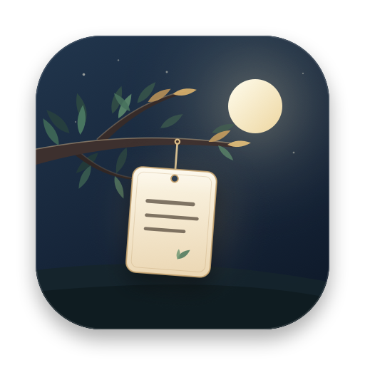
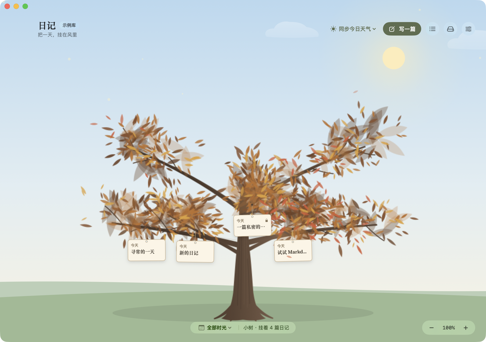
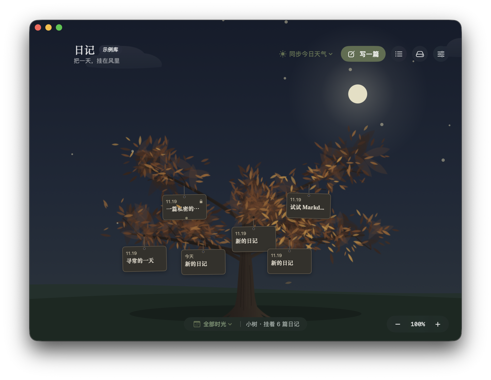
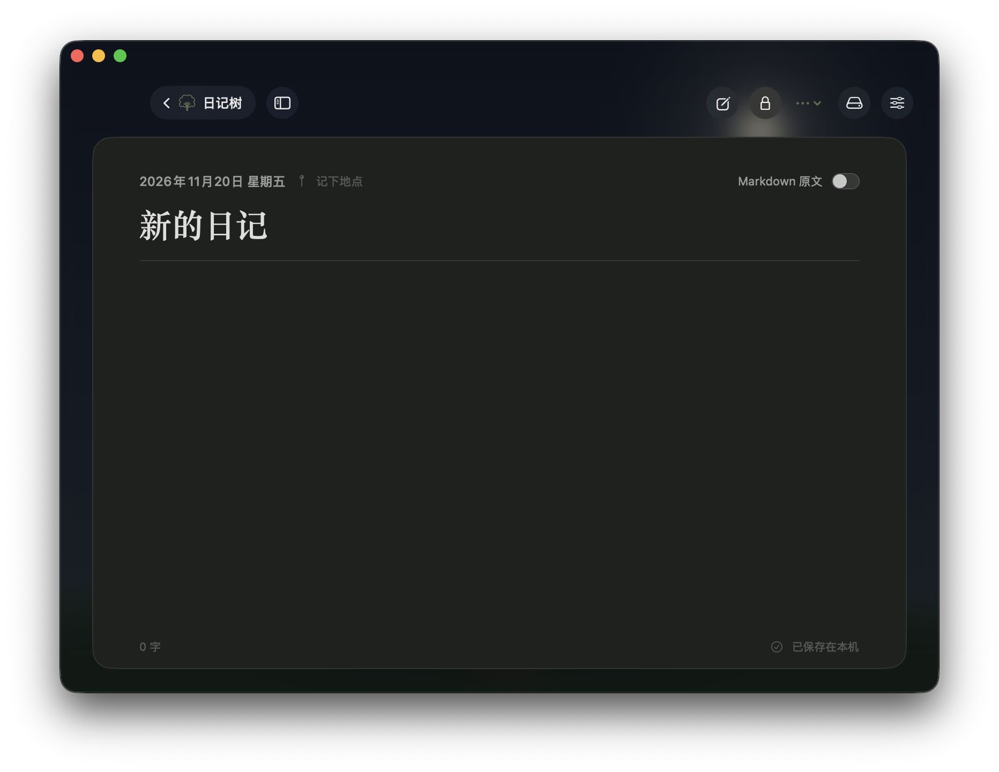

<p align="center">
  
</p>

<h1 align="center">Arbour · 栖木</h1>

<p align="center">
  <strong>Hang your day in the wind.</strong><br />
  A lightweight, serene, local-first native macOS diary app.
</p>

<p align="center">
  <a href="README.md"><strong>English</strong></a> &nbsp;|&nbsp; <a href="README.zh-CN.md">简体中文</a>
</p>

<p align="center">
  <a href="https://github.com/linzihong594/arbour/releases/latest">
    
  </a>
  
  
  
  
</p>

---

## Overview

**Arbour (栖木)** is a quiet, private journaling app crafted natively for macOS. No accounts, no cloud tracking, no Electron, and no background daemons — every entry lives safely on your own disk and appears on your home screen as a wooden plaque gently swaying from a tree branch. As your entries grow, your tree genuinely grows taller, sprouts new leafy boughs, and shifts through the four seasons.

### Screenshots

| Diary Tree · Autumn (Light) | Diary Tree · Night (Dark) | Distraction-Free Paper Editor |
| :---: | :---: | :---: |
|  |  |  |

---

## Download

Grab the prebuilt **Apple Silicon (`arm64`)** package from [**GitHub Releases**](https://github.com/linzihong594/arbour/releases/latest):

- **`Arbour-0.6.0-macOS-arm64.dmg`** — Drag `栖木.app` into your `Applications` folder.
- **`Arbour-0.6.0-macOS-arm64.zip`** — Unzip and launch directly.

> **First-Launch Note (Unsigned / Ad-hoc Build):**
> This open-source release is **ad-hoc signed** and not notarized with a paid Apple Developer ID. On first launch, macOS Gatekeeper may warn that the app cannot be verified. To open it after inspecting or downloading:
> ```bash
> xattr -cr "/Applications/栖木.app"
> ```
> Or build directly from source in seconds (see [Build from Source](#build-from-source) below).
> Per-entry password encryption, local backups, maps, and weather all work out of the box; **Touch ID** unlocking requires signing with your own Apple Development certificate & provisioning profile in Xcode.

---

## Key Features

- **A Living, Growing "Diary Tree" Home**
  - **Genuine Structural Growth**: As you write more entries, the tree organically grows taller and sprouts 28 stage-gated leafy boughs across 5 stages — **Sapling (0) → Young Tree (1–10) → Lush Tree (11–50) → Ancient Tree (51–200) → Giant Tree (200+)** — unlocking more primary hanging slots (`3 → 22`).
  - **Four Seasons, Day/Night Sky & Live Weather**: Foliage automatically adapts to the month (**Spring** cherry blossoms, **Summer** deep emerald, **Autumn** ginkgo gold & maple crimson, **Winter** frosted pine). Sky gradients and sun/moon arcs shift across dawn, day, dusk, and night, paired with 6 live weather scenes (clear, cloudy, fog, rain, snow, thunderstorm) and a preview switcher.
  - **1,000-Entry Canopy LOD & Smooth Zoom/Pan**: Zoom smoothly between `70%` and `260%` via pinch, double-click, or `⌘+`/`⌘-`/`⌘0`. Hundreds or thousands of older entries render as lightweight miniature silhouettes across the upper canopy and automatically expand into full interactive plaques when you zoom in (`≥ 1.40×`), plus quick Year/Month filtering.
  - **Tactile Interactions**: Gentle wind-driven plaque sway (automatically pauses to `0.0% CPU` when hidden or minimized), spring drop-in when hanging a new entry, right-click context menu (Open / Lock / Export Markdown / Move to Trash), and a falling-and-dissolving animation on delete while safely preserving the entry in Trash for one-click restore.
- **Immersive Paper-Sheet Markdown Writing**
  - Centered letter-paper writing surface resting over a softly blurred static tree backdrop (`0%` extra animation CPU while writing).
  - Native **TextKit 2** inline Markdown rendering via [MarkdownEngine](https://github.com/nodes-app/swift-markdown-engine), with one-click toggle to raw Markdown source.
  - 350 ms debounced atomic disk writes, UUID-based files (multiple entries per day), slide-out directory drawer with title & date filtering, Trash recovery, and explicit Markdown export.
- **Per-Entry Encryption & Strict Privacy Boundaries**
  - Each private diary is encrypted independently using **CryptoKit** authenticated encryption with a unique per-entry password, salt, and key. Body text, location, and weather live inside the ciphertext — no full-text search index and no temporary plaintext files.
  - Switching entries, quitting, or locking the Mac immediately clears the native text view, undo stack, and accessibility cache, leaving only a locked placeholder.
  - Optional **Touch ID** key unlocking (when built with an Apple Development/Developer ID signature), always with password fallback.
- **On-Demand Location, Map Picker & Daily Weather**
  - Single-shot **Core Location** requests that stop immediately after acquiring coordinates (never tracks in the background), plus manual **MapKit** pin picking and reverse-geocoded place names.
  - On-demand **Open-Meteo** daily weather snapshots for confirmed coordinates; network failures or timeouts never block writing, and past entries are never stamped with today's weather.
- **Immutable Local Snapshot Backups & Isolated Restore**
  - Choose any local folder or external drive to write immutable snapshots containing `Entries/`, `Trash/`, per-file SHA-256 `manifest.json`, and a `COMPLETE` marker (retaining the latest 5 complete snapshots).
  - Supports **post-save quiet auto-backup**, **daily auto-snapshot (24h)**, and **backup-on-quit** (only when entries changed, zero delay otherwise), plus one-click **Open in Finder** and latest snapshot timestamp/size summary.
  - Restores write only into an empty target directory after verifying every SHA-256 checksum, rejecting tampered, incomplete, or unexpected files without ever overwriting your live library.

---

## Lightweight Benchmarks

Measured on a Release build with **1,000 synthetic on-disk diaries** and a **10,000-character** newest document (Apple Silicon, macOS 14+):

| Metric | Budget | Measured Result |
| --- | --- | --- |
| App Bundle Size (`栖木.app`) | ≤ 30 MiB | **`7.95 MiB`** |
| Cold Start (1,000 entries, 5-run median) | ≤ 2.0 s | **`0.434 s`** |
| 60s Idle Physical Footprint (1,000 entries) | ≤ 100 MiB | **`81.08 MiB`** |
| 60s Idle Average CPU | < 1.0% | **`0.33%`** (`0.0%` when hidden/minimized) |
| 10k-Char Markdown Edit Latency (P95) | ≤ 300 ms | **`15.48 ms`** |
| Background Daemons / Telemetry | 0 | **0** |

---

## Build from Source

### Requirements

- macOS 14.0 or later
- Xcode Command Line Tools (Swift 6+) and Python 3

### Build & Run

```bash
git clone https://github.com/linzihong594/arbour.git
cd arbour

# Build Release app (generates ./build/栖木.app and renders the full AppIcon.icns)
python3 scripts/manage.py build

# Launch isolated demo library (never touches your real local diaries)
open -n "./build/栖木.app" --args --demo

# Launch your normal local library (starts empty on first launch)
open "./build/栖木.app"
```

### Tests & Verification

```bash
# Run all 93 Swift Testing unit tests (crypto, storage, trash, location, weather, backup, security)
python3 scripts/manage.py test

# Cross-process persistence, encryption recovery, and trash probes
python3 scripts/verify.py

# Backup snapshot, SHA-256 verification, isolated restore, and tamper-rejection probes
python3 scripts/verify_backup.py
```

---

## Project Structure

```text
├── Sources/
│   ├── DiaryCore/       # Models, atomic storage, CryptoKit encryption, immutable snapshots (no UI)
│   ├── DiaryPlatform/   # Keychain/Touch ID, Core Location, Open-Meteo weather, security bookmarks
│   ├── DiaryState/      # Draft sessions, debounced autosave, lock/undo security boundaries (no UI)
│   ├── DiaryEditing/    # Native Markdown editor bridge
│   ├── DiaryApp/        # SwiftUI UI: TreeHome, Editor (Paper Reader), Workspace & Backup panels
│   ├── DiaryProbe/      # Cross-process persistence & recovery probe (dev only)
│   └── EditorProbe/     # IME, GFM table, 10k-char latency & memory/undo cleanup probe (dev only)
├── Tests/               # 93 unit tests organized by module
├── Resources/           # Info.plist and app metadata
├── scripts/             # Build, programmatic vector icon renderer (draw_icon.swift), and verification
└── docs/                # User guide, architecture, data format, and third-party notices
```

---

## Security & Privacy Notes

- **Lost Passwords Cannot Be Recovered**: Arbour has no account system and no cloud key escrow. If you forget the password to an encrypted diary, its ciphertext body is **permanently unrecoverable**.
- **iCloud Cloud Sync**: The current release focuses on reliable local immutable snapshot backups. iCloud Drive cloud upload state verification is deferred to a future milestone.

---

## Acknowledgments & License

- Native inline Markdown editing is powered by [nodes-app/swift-markdown-engine](https://github.com/nodes-app/swift-markdown-engine) (Apache License 2.0). See [docs/THIRD_PARTY.md](docs/THIRD_PARTY.md).
- Released under the [MIT License](LICENSE).
