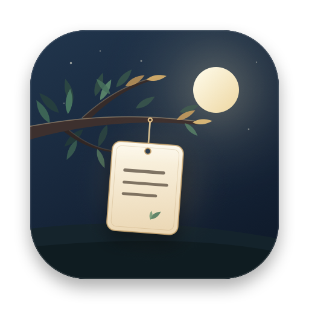
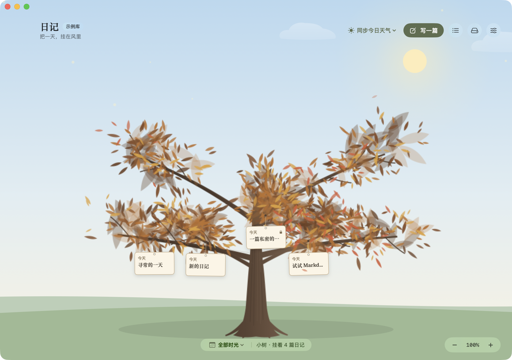
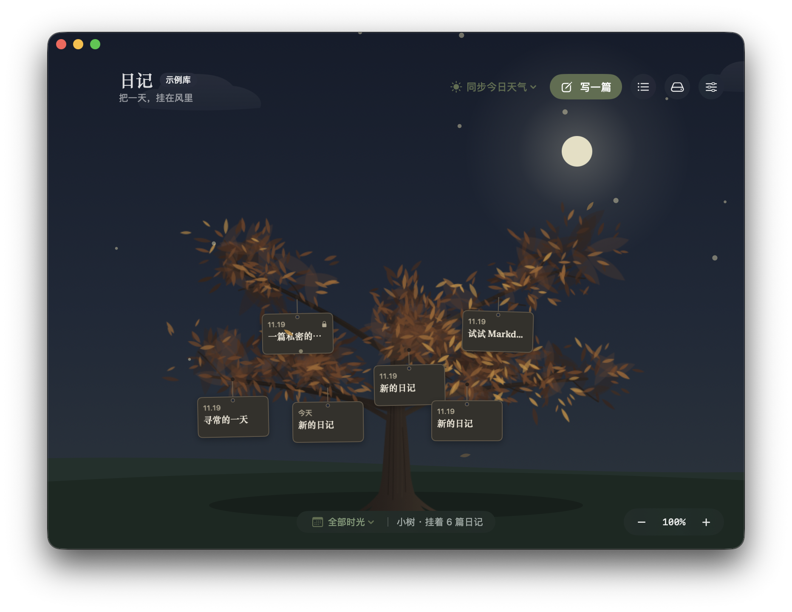
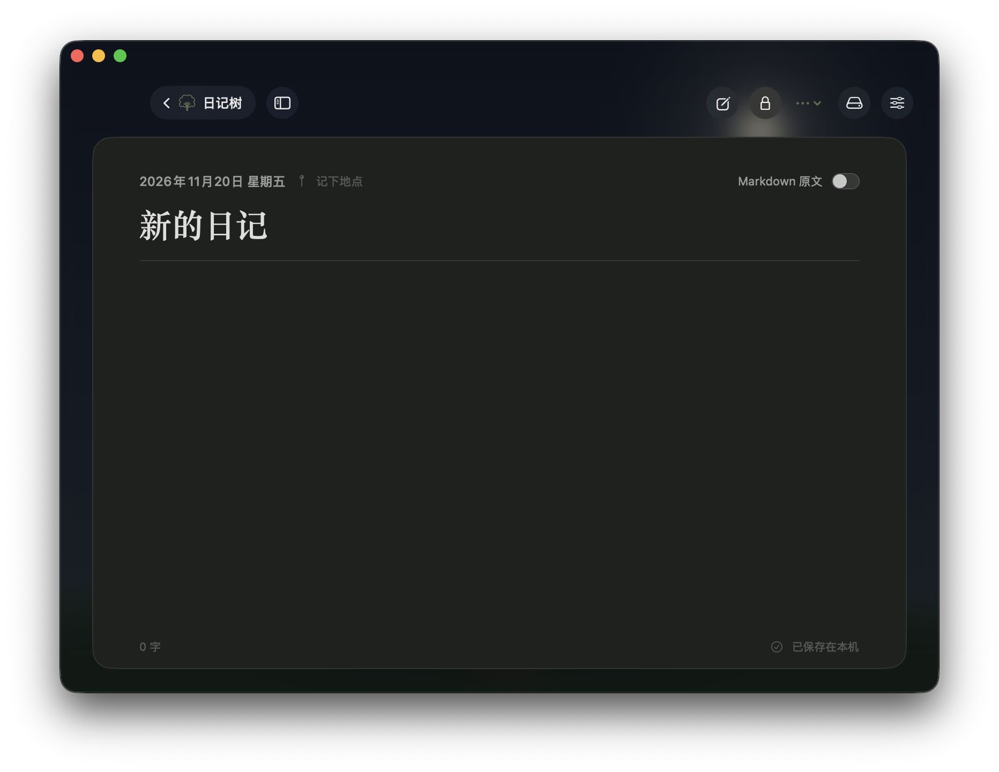

<p align="center">
  
</p>

<h1 align="center">栖木 · Arbour</h1>

<p align="center">
  <strong>把一天，挂在风里。</strong><br />
  一款轻量、优雅、本地优先的原生 macOS 日记应用。
</p>

<p align="center">
  <a href="README.md">English</a> &nbsp;|&nbsp; <a href="README.zh-CN.md"><strong>简体中文</strong></a>
</p>

<p align="center">
  <a href="https://github.com/linzihong594/arbour/releases/latest">
    
  </a>
  
  
  
  
</p>

---

## 简介

**栖木（Arbour）** 是一款为 Mac 打造的轻量级私人日记应用。没有账户系统、没有云端追踪、没有 Electron 或常驻后台守护进程——每一篇日记都安静地保存在你自己的硬盘里，并在主页化作一枚轻挂枝头的木牌。随着写下的日子越来越多，大树会真实地拔高、抽枝、随四季换色，陪你收藏每一段安静的时光。

### 界面预览

| 日记树 · 浅色秋季 | 日记树 · 深色夜空 | 沉浸式信纸写作 |
| :---: | :---: | :---: |
|  |  |  |

---

## 下载安装

前往 [**GitHub Releases**](https://github.com/linzihong594/arbour/releases/latest) 直接下载预编译的 **Apple Silicon（`arm64`）** 软件包：

- **`Arbour-0.6.0-macOS-arm64.dmg`** — 双击打开后将 `栖木.app` 拖入「应用程序」文件夹即可。
- **`Arbour-0.6.0-macOS-arm64.zip`** — 解压后直接运行。

> **首次打开说明（未公证开源版）：**
> 当前开源预编译包采用本地 ad-hoc 签名，未经过付费 Apple Developer ID 公证。从网络下载后首次打开时，macOS 可能会提示「无法验证开发者」。在确认来源后，可在终端运行以下一行命令放行：
> ```bash
> xattr -cr "/Applications/栖木.app"
> ```
> 或直接从源码秒级构建（见下方 [快速开始](#快速开始)）。单篇密码加密、本地快照备份、定位、地图与天气均开箱即用；**Touch ID** 指纹解锁需使用你自己的 Apple Development 证书与 profile 在 Xcode 重签后启用。

---

## 核心特性

- **会生长的「日记树」主页**
  - **真实结构成长**：随着日记篇数积累，大树从 **幼苗（0 篇）→ 小树（1–10 篇）→ 繁茂大树（11–50 篇）→ 参天古树（51–200 篇）→ 记忆巨木（200+ 篇）** 真实拔高主干并逐层长出 28 条带叶新枝，逐步解锁更多挂牌枝位（`3 → 22`）。
  - **四季色板与昼夜天气**：按当前月份自动演进 **春（新绿樱粉）/ 夏（苍翠浓荫）/ 秋（金杏枫红）/ 冬（清霜雪枝）**；按时段流转晨曦、白昼、黄昏与深夜天空；支持按当天位置同步晴、多云、雾、雨、雪、雷雨 6 种天气场景（右上角菜单支持自由预览）。
  - **千篇 LOD 远近分层与缩放漫游**：支持 `70%–260%` 捏合/拖拽/快捷键缩放；数百上千篇日记以轻量微缩木牌缀满树冠，放大推近至 `≥ 1.40×` 自动在视野内展开为可点击木牌；底部支持按年/月快速定位。
  - **鲜活交互细节**：木牌随风轻柔摆动（窗口隐藏或最小化自动降至 `0.0% CPU`）、新日记落枝挂上、右键菜单直达打开/加密/导出/移入废纸篓，删除时呈现断绳坠落草地并化作光点消散的短动效（数据安全保留在废纸篓中，随时可恢复）。
- **沉浸式信纸阅读与原生 Markdown 写作**
  - 静态虚化树影背景下的居中书页编辑区（写作期间树动画完全停止，0% 额外动画 CPU）。
  - 基于原生 TextKit 2（[MarkdownEngine](https://github.com/nodes-app/swift-markdown-engine)）实现行内即时渲染，并支持一键切换 Markdown 原文。
  - 350 ms 防抖原子保存、UUID 独立文件（同日可写多篇）、标题/日期筛选、侧滑目录抽屉与显式 Markdown 导出。
- **单篇独立加密与隐私边界**
  - 每篇私密日记拥有独立口令与随机盐/密钥（CryptoKit 认证加密），正文、位置与天气全部保存在密文内；不建立正文搜索缓存，不生成临时明文文件中转。
  - 退出、切换日记或系统锁屏后立即清除原生视图正文与撤销栈，仅显示锁定占位。
  - 支持在有效 Apple 签名环境下启用 **Touch ID** 生物识别解锁（密码始终作为独立回退途径）。
- **按需定位、地图选点与当天天气**
  - Core Location 单次按需定位，请求结束立即停止，绝不后台持续追踪；支持 MapKit 地图手动选点与逆地理编码地名。
  - 按确认坐标按需请求 Open-Meteo 天气快照，断网或超时不阻塞写作，过去日期不误填今日天气。
- **本地不可变快照备份与隔离恢复**
  - 选择任意本地目录（或外置硬盘目录）创建不可变快照，包含 `Entries/`、`Trash/`、`manifest.json` 逐文件 SHA-256 校验与 `COMPLETE` 完成标记，默认保留最近 5 份完整快照。
  - 支持 **保存后静置自动快照**、**每日自动快照（24 小时）** 与 **退出前自动备份本次改动**（无改动零延迟），并内置 **在 Finder 中打开** 按钮与最近一次备份时间/体积摘要。
  - 恢复强制写入空目录并先验签，拒绝半成品、篡改、清单外文件与非空目标，绝不覆盖唯一副本；恢复后保留原 UUID 与加密容器，可仅凭原密码独立解密。

---

## 轻量化实测数据

以下数据来自 Release 构建在 **1,000 篇合成日记 + 10,000 字最新长文** 数据集上的本机实测（Apple Silicon，macOS 14+）：

| 指标 | 初始预算 | 实测结果 |
| --- | --- | --- |
| 应用包逻辑体积（`栖木.app`） | ≤ 30 MiB | **`7.95 MiB`** |
| 千篇冷启动耗时（5 次中位数） | ≤ 2.0 s | **`0.434 s`** |
| 千篇 60 秒空闲物理内存 | ≤ 100 MiB | **`81.08 MiB`** |
| 千篇 60 秒空闲平均 CPU | < 1.0% | **`0.33%`**（窗口隐藏/最小化 **`0.0%`**） |
| 万字 Markdown 连续编辑延迟（P95） | ≤ 300 ms | **`15.48 ms`** |
| 后台常驻进程 | 0 个 | **0 个**（无自建守护进程、无遥测） |

---

## 快速开始

### 环境要求

- macOS 14.0 或更高版本
- Xcode Command Line Tools（Swift 6+）与 Python 3

### 从源码构建与运行

```bash
git clone https://github.com/linzihong594/arbour.git
cd arbour

# 构建 Release 应用（生成 ./build/栖木.app，并自动渲染全套图标）
python3 scripts/manage.py build

# 启动独立示例库体验（不影响本机真实日记）
open -n "./build/栖木.app" --args --demo

# 启动正常本地库（首次启动为空）
open "./build/栖木.app"
```

### 运行测试与验证

```bash
# 运行全部 93 项 Swift Testing 单元测试
python3 scripts/manage.py test

# 运行跨进程持久化、加密恢复与废纸篓探针
python3 scripts/verify.py

# 运行本地备份快照、SHA-256 校验、隔离恢复与 4 类篡改拒绝测试
python3 scripts/verify_backup.py
```

---

## 工程结构

```text
├── Sources/
│   ├── DiaryCore/       # 数据模型、原子持久化、CryptoKit 单篇加密、不可变快照备份（无 UI 依赖）
│   ├── DiaryPlatform/   # Keychain / Touch ID、Core Location、Open-Meteo 天气、目录安全书签
│   ├── DiaryState/      # 草稿会话、防抖自动保存、锁定/撤销安全边界（无 UI 依赖）
│   ├── DiaryEditing/    # 原生 Markdown 编辑器桥接层
│   ├── DiaryApp/        # SwiftUI 界面：TreeHome（日记树）、Editor（沉浸信纸）、Workspace（抽屉/面板）
│   ├── DiaryProbe/      # 跨进程持久化与恢复验证探针（不进入正式应用）
│   └── EditorProbe/     # 输入组合、表格、长文与内存/撤销清理验证探针
├── Tests/               # 按模块组织的 93 项单元测试
├── Resources/           # Info.plist 等应用资源
├── scripts/             # 构建打包、矢量程序化图标生成（draw_icon.swift）与自动化验证脚本
└── docs/                # 使用说明、架构设计、数据格式与开源致谢
```

更多说明请阅读：[使用与发行说明](docs/USER_GUIDE.md) · [技术架构](docs/ARCHITECTURE.md) · [本地数据格式](docs/DATA_FORMAT.md) · [需求与轻量化预算](docs/PRODUCT.md)

---

## 安全与使用须知

- **密码丢失无法恢复**：栖木没有账户系统、没有云端密钥托管。若遗忘某篇私密日记的密码，该篇密文正文将**永久无法解密**，请妥善保管密码。
- **签名与 Touch ID**：预编译包与源码默认构建采用本机 ad-hoc 签名，除 Touch ID 生物识别（依赖 Apple 签名与受保护 Keychain 授权）外，其余全部功能均可正常使用。
- **iCloud 云端上传**：当前首版聚焦可靠的本地目录不可变快照备份；iCloud Drive 云端上传状态闭环计划在后续版本单独完善。

---

## 开源致谢与许可

- 核心原生 Markdown 编辑器复用了 [nodes-app/swift-markdown-engine](https://github.com/nodes-app/swift-markdown-engine)（Apache License 2.0），详见 [THIRD_PARTY.md](docs/THIRD_PARTY.md)。
- 本项目基于 [MIT License](LICENSE) 开源。
